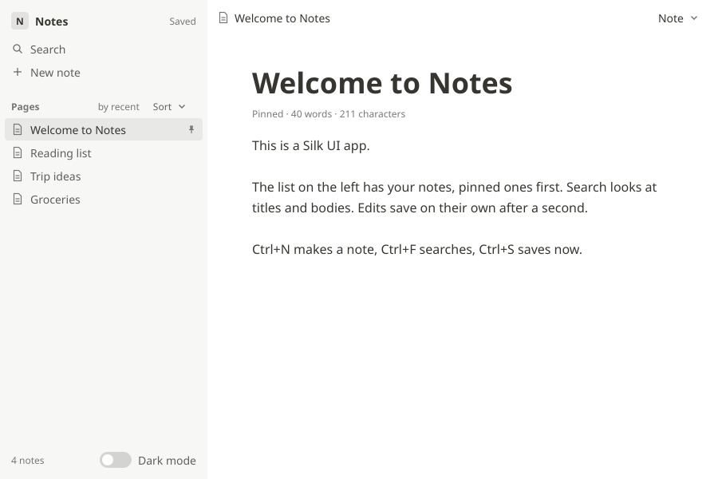

# Notes

The example app of the Silk UI stack: a notes app in a native window, built with
[ui-app](../../ui/app) and [ui-components](../../ui/components) on the retained [ui-tree](../../ui/tree). It is
small enough to read in one sitting and does what a real app does: it loads and saves a file,
filters and sorts a list, edits text, asks before deleting, has keyboard shortcuts and a dark
theme, and can be inspected and driven by tests, the devtools window and agents.



Packages:

- `examples/notes` (`ui-notes`): the app as a library: `notes` (model, messages, `update`, `view`,
  subscriptions, the `Save` command and the `Store` service), `look` (palette and icons),
  `format` (the notes file as JSON) and `text` (word counts, search matching, previews).
- `examples/notes/app` (`ui-notes-app`): the window. It reads and writes the notes file and serves the
  inspector in debug builds.
- `examples/notes/tests`: scripted tests through the real tree, and `describe` and PNG goldens.

## Running it

```sh
python3 scripts/install-silk && python3 scripts/install-llvm   # once, see the repository README
examples/notes/core/scripts/notes                       # debug build, notes in ~/.silk-notes.json
examples/notes/core/scripts/notes --release --file my-notes.json
```

On Linux it needs `libx11-dev libxkbcommon-dev libwayland-dev` (see
[examples/graphics-demo](../graphics-demo)); on macOS and Windows nothing extra. The first run starts
with a few sample notes. Edits are saved a second after they happen, or at once with Ctrl+S
(Cmd+S on macOS); the file is replaced atomically, so a crash never leaves half a file. A file
that is not a notes file is left alone: the app says so and exits.

| Keys | |
| --- | --- |
| Ctrl+N, Cmd+N | a new note, its title ready to type |
| Ctrl+F, Cmd+F | the search field; Enter opens the first match, Escape clears the search |
| Ctrl+S, Cmd+S | save now |
| Up, Down, Home, End | in the list, move the selection |
| Tab, Shift+Tab | through the sidebar (search, New note, Sort, the list, Dark mode), then the Note menu, title and body |

To look inside it while it runs, start it with the devtools window next to it:

```sh
ui/inspect/devtools/core/scripts/devtools notes
```

`ui-inspect-cli` and `ui-inspect-mcp` reach it the same way (debug build, `SILK_UI_INSPECT`
set): see [ui/inspect/server](../../ui/inspect/server).

## How it is built

The app follows the Elm architecture of ui-app. Everything it knows is in one model, `Notes`;
everything that can happen is a `Message`; `update` is the only code that changes the model, and
`view` describes the window from the model alone.

**Model.** The notes (`List<Note>`, each with an id, title, body, pinned flag and an edit stamp),
which note is selected (by id, so it survives sorting and filtering), the search text, the sort
order, the state of the Note menu, the Sort select and the delete dialog, and the save
bookkeeping: `revision` counts changes, `savedRevision` is the one the store last confirmed.

**Look.** A document-first design in the spirit of Notion: a warm gray sidebar of flat rows
with line icons (drawn as canvas nodes), and a borderless page with a breadcrumb bar, a large
title and the body in a centered column. The palette, for light and dark, is in `look.silk`,
as a ui-components `Theme` plus a few sidebar colors.

**View.** A sidebar and a page. The list shows `visible()`: the notes matching the search,
pinned first, then by the sort order. It is computed from the model on every render and never
stored, so it cannot go stale. Each row is keyed by its note's id, so the tree keeps a row's
node, hover and scroll state when notes move. The editor's title and body are controlled inputs:
the tree edits the text (caret, selection, clipboard, undo, input methods) and sends the new
value, `update` stores it, and the next render passes it back.

Handlers are lambdas that are called during dispatch and never stored. `|at| Message.Select {
id: notes[shown[at]].id }` reads the list as it is when the click arrives.

**Focus** is a request in the model: `update` sets `focus` (search, title or body) and the next
render calls `ui.takeFocus()` on that input. `update` clears it first thing, so the request
lasts one render. New note focuses the title, Enter in the search focuses the body, closing the
dialog gives focus back to the body.

**Saving** is the app's one effect. Every change bumps `revision`. While the store is behind,
`subscriptions` asks for an `every(1s)` timer whose message, `AutoSave`, makes `update` return a
`Save` command carrying the JSON text. The command's `perform` calls the `Store` service, which
the host provides: the window app's store writes the file, the tests' store keeps the text in
memory, and another one fails on purpose to test the "Not saved" state. When the store confirms,
the subscription is no longer asked for and the timer stops; after a failure it waits for the next
edit instead of retrying in a loop.

**Shortcuts** are `keyBinding` subscriptions, so they work wherever focus is, inside the inputs
too.

## Testing

```sh
silk test --manifest-path examples/notes/tests/silk.toml --root src/tests.silk
silk build --manifest-path examples/notes/tests/silk.toml
examples/notes/tests/build/llvm/x86_64-unknown-linux-gnu/debug/ui-notes-tests examples/notes/tests/goldens
examples/notes/core/scripts/notes check                # the app in X11 and Wayland windows (Linux)
ui/inspect/devtools/core/scripts/devtools check  # the devtools window inspecting the app
```

The tests drive the app through the tree's real input path with the ui-app harness (clicks by
role and name, key presses, typed text, the clock) and check the model, the `describe` snapshot
and what the store received: start-up and list keys, a new note typed and autosaved (the saved
JSON is read back), search with Enter and Escape, pinning and both sort orders, duplicate, delete
with its dialog (Cancel, Escape, Delete, deleting everything), dark mode and failing saves, and a
keyboard-only run. The goldens are five scenes: the start, a new note being typed, a search, the
delete dialog, and dark mode with the Note menu open. CI runs all of it in `ui-notes.yml`, and
the devtools exit test in `ui-inspect.yml`.

## What it found

Building a real app on the stack turned up two gaps in ui-components, fixed here: a menu whose
button sits at the right edge of the window opened its list past the edge
(`MenuState.endAligned()` lines the list up with the button's right edge), and a menu button
could only have the bordered look (`.ghosted()` gives it the quiet ghost look for toolbars).

## Limits

- One window, one notes file; no folders or tags.
- The search matches ASCII letters without case; other scripts match exactly.
- The text is plain: no rich text, links or images in notes.
- A Windows path as the file argument is not understood yet (the std file system takes
  `/C:/...` paths); without an argument the file goes in the working directory there.
